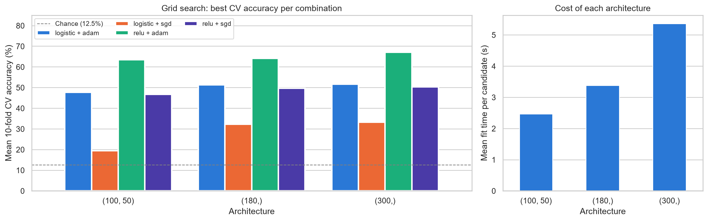
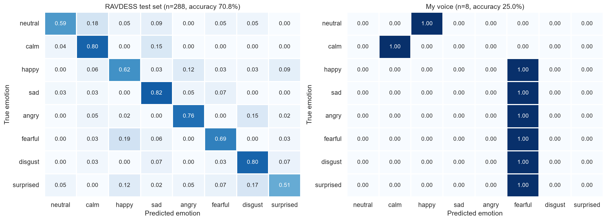
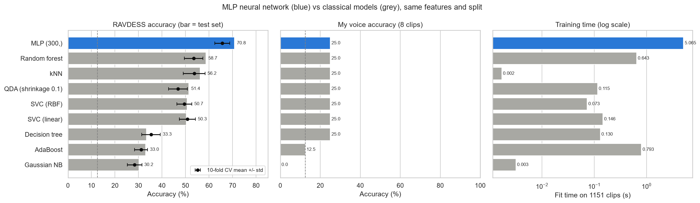

# Week 4: Neural Network (MLP) Emotion Classification on RAVDESS and My Voice

**Name:** Benjamin Nichiporik | **Student ID:** [ADD] | **GitHub:** Fallenfour-png | **Repository:** https://github.com/Fallenfour-png/Week4-NeuralNetworks/tree/Ben_Assignment_4 | **My recordings:** [ADD ONEDRIVE LINK]

## 1. Process

I used the same 180 features per clip as in Weeks 2–3 (means of 12 chroma, 128 mel and 40 MFCC bands) from the 1439 RAVDESS speech clips (Actors 01–24). My 8 recordings (Actor 25, one clip per emotion) are in a separate folder and never used for training or tuning. I fixed the tutorial's stereo-to-mono step (`librosa.to_mono(waveform.T)`). Before, stereo files collapsed to 2 samples and gave impossible values (MFCC minimum −1131 instead of −873). RAVDESS was split 80/20 (`random_state=42`, 288 test clips, the same split as Week 3), and the 80% was split again 60/20 into train/validation to choose the scaling. A default MLP reached 45.8% validation accuracy unscaled, 46.5% with MinMax and 58.7% with standard scaling, so I used StandardScaler. I tuned hyperparameters by grid search with 10-fold CV on the 80%, trained the final model on it, and scored the test set once. My clips were scored separately with the RAVDESS-fitted scaler. Finally, I retrained Week 3's eight classical models on the same split for comparison.

## 2. Hyperparameter selection

The grid had 48 candidates (480 fits, about 100 s on 20 CPU cores): hidden layers (180,), (300,) or (100, 50); relu or logistic activation; adam or sgd solver; alpha 0.001 or 0.01; adaptive or constant learning rate. The best was **relu + adam, one hidden layer of 300 neurons, alpha 0.001** (67.2% CV accuracy).

*Figure 1. Best 10-fold CV accuracy per architecture and activation/solver pair (left); mean fit time per candidate (right).*

- **Activation and solver mattered most.** Relu + adam won for every architecture by 13–16 points. Logistic units saturate and shrink the gradients, and plain SGD had not converged within the default 200 epochs (logistic + sgd: 19–33%); Adam adapts each weight's step size and converges faster.
- **Architecture.** One 300-neuron layer beat 180 neurons (64.1%) and two layers (100, 50: 63.4%). With about 1150 training clips, extra depth only adds weights to fit; 300 neurons cost 1.6× the fit time of 180.
- **Alpha** (L2 penalty) changed CV accuracy by only 0.3 points. **The learning-rate schedule** had no effect because scikit-learn applies it only to SGD.

With `batch_size=256` and `max_iter=1000`, training stopped when the loss converged (342 epochs). The final model scores 100% on training data but 70.8% on the test set, and the learning curve keeps a large train/CV gap: the MLP overfits (high variance), as expected for about 56,700 weights learned from 1151 clips.

## 3. Results: RAVDESS test set vs my voice

| Score | RAVDESS test set (288 clips) | My voice (8 clips, scored separately) |
|---|---|---|
| Accuracy | **70.8%** | **25.0%** (2/8) |
| Precision / Recall (macro) | 70.8% / 70.1% | 14.6% / 25.0% |
| F1 (macro) | 69.8% | 16.1% |
| 10-fold CV accuracy (training set) | 65.6% ± 3.2% | – |

**RAVDESS.** My 70.8% (204/288) is 3–4 clips above the tutorial's Colab run (69.4%) and a classmate's (69.8%). The chosen hyperparameters are identical; newer scikit-learn/librosa versions and my stereo fix change the features and training slightly, a gap well within the ±3.2% CV spread. Precision is close to recall, so errors are spread evenly. Calm, sad and disgust are recognized best (80–83% recall, Figure 2), and surprised (51%) and neutral (59%) are the weakest. The confusions make acoustic sense. Calm→sad and neutral→calm are low-arousal pairs. Surprised→disgust/happy, fearful→happy and angry→disgust are high-arousal pairs with similar energy and pitch. Averaging features over the clip removes the sentence's time course, where these pairs differ.

**My voice.** Only calm and fearful were correct (Figure 2, right). The MLP predicted "fearful" for 6 of 8 clips, with 98–100% confidence. In Week 3 I found that my recordings are about 3.3× louder than RAVDESS (home microphone, 44.1 kHz stereo), so after scaling my mel features fall far outside the training range. A ReLU network extrapolates linearly there, so one output dominates and softmax becomes over-confident. Week 3's kNN did the same with "angry". The drop from 71% to 25% therefore comes mostly from the different recording setup and an unseen speaker, not from the model type.

*Figure 2. Row-normalized confusion matrices (recall per emotion) of the final MLP. Counts are in `results/confusion_matrices.png`.*

## 4. Neural network vs classical models

*Figure 3. MLP (blue) vs Week 3's classical models (grey) on the same features and split. The dashed line is chance (12.5%).*

| Model | RAVDESS test | 10-fold CV | My voice | Fit time | Predict 288 clips |
|---|---|---|---|---|---|
| **MLP (300,)** | **70.8%** | **65.6 ± 3.2%** | 2/8 | 5.1 s (+98 s grid search) | 1.2 ms |
| Random forest | 58.7% | 53.4 ± 4.0% | 2/8 | 0.64 s | 8.0 ms |
| kNN | 56.3% | 53.7 ± 4.6% | 2/8 | 0.002 s | 52.2 ms |
| SVC (RBF) | 50.7% | 49.5 ± 3.2% | 2/8 | 0.07 s | 30.1 ms |

**Accuracy.** The MLP beats the best classical model by about 12 points on the test set and in CV, and my best Week 3 result (kNN with MinMax, 60.1%) by 10.7 points. Its hidden layer learns non-linear combinations of all 180 correlated spectral features, for example energy in certain mel bands together with MFCC shape. kNN uses a plain distance in which every noisy feature counts equally, trees split one feature at a time, Gaussian NB assumes independent features, and linear SVC draws only straight boundaries.

**Computational efficiency.** The MLP is the most expensive to train. One fit takes about 5 s (8× random forest, over 2000× kNN) because backpropagation makes 342 passes over the data, and its sensitive hyperparameters needed a grid search, while the classical models worked with defaults. Prediction is the reverse: the MLP needs about 1 ms for 288 clips (two matrix multiplications), while kNN takes 52 ms because it compares every test clip with all 1151 training clips.

**Generalization.** On my voice every model scored 25% or less (Week 3 best: 3/8), so the extra capacity does not carry over to a new speaker and microphone. Classical models train faster, need less tuning and are easier to interpret, but plateau lower on these features. Loudness normalization, more speakers (or my clips) in training, and CNN/LSTM models on spectrograms that keep timing information would likely help more than a bigger MLP.

## References

1. Livingstone, S. R., & Russo, F. A. (2018). The Ryerson Audio-Visual Database of Emotional Speech and Song (RAVDESS). *PLoS ONE, 13*(5), e0196391. https://zenodo.org/record/1188976
2. Nichiporik, B. (2026). Actor 25 voice recordings (8 clips, RAVDESS naming). OneDrive: [ADD LINK].
3. IAT-ExploringAI. Week4-NeuralNetworks tutorial notebook. https://github.com/IAT-ExploringAI-2024/Week4-NeuralNetworks
4. Pedregosa, F., et al. (2011). Scikit-learn: Machine learning in Python. *JMLR, 12*, 2825–2830; McFee, B., et al. librosa. https://librosa.org
